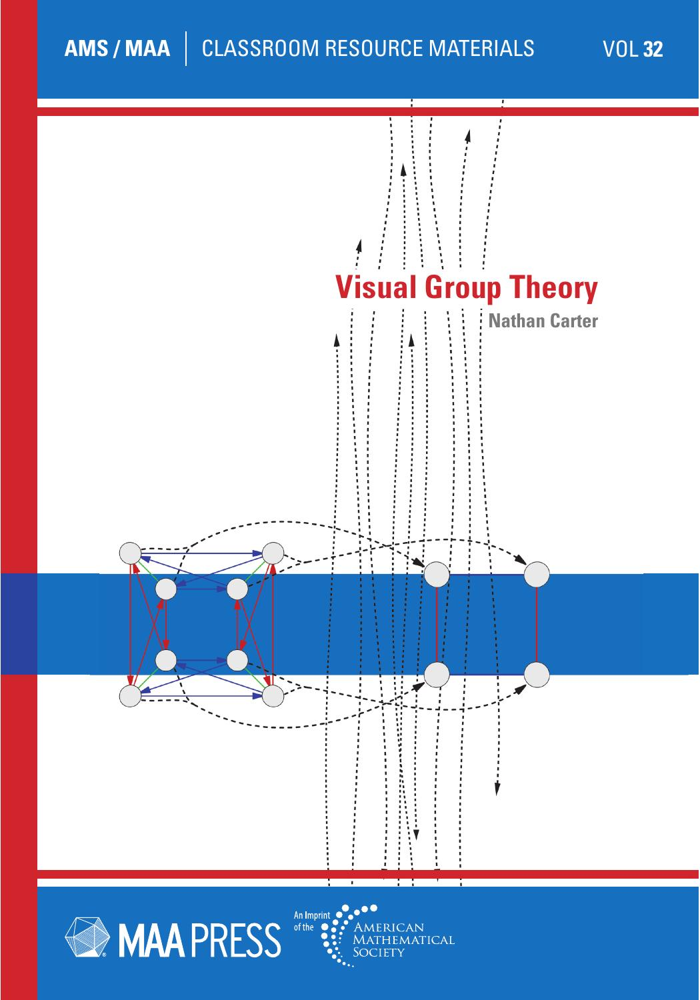
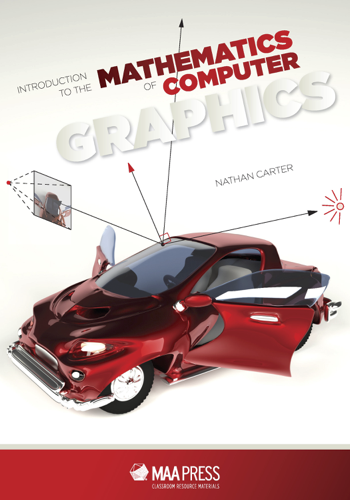
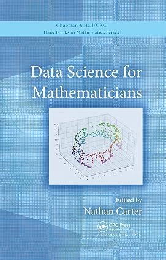

:::: {.columns}

::: {.column width="25%"}

&nbsp;

{fig-align="left" width="150px"}

:::

::: {.column width="75%"}

## Visual Group Theory

Mathematics Association of America Press, 2009

[Textbook site (summary, errata, etc.)](vgt.qmd){.btn .btn-primary role="button"}

[Publisher website](https://bookstore.ams.org/clrm-32/){.btn .btn-secondary role="button"}
[Amazon page](https://www.amazon.com/Visual-Theory-Classroom-Resource-Materials/dp/1470464330){.btn .btn-secondary role="button"}

:::

::::

Group theory is the branch of mathematics that studies symmetry, found in crystals, art, architecture, music and many other contexts, but its beauty is lost on students when it is taught in a technical style that is difficult to understand. Visual Group Theory assumes only a high school mathematics background and covers a typical undergraduate course in group theory from a thoroughly visual perspective. The more than 300 illustrations in Visual Group Theory bring groups, subgroups, homomorphisms, products, and quotients into clear view. Every topic and theorem is accompanied with a visual demonstration of its meaning and import, from the basics of groups and subgroups through advanced structural concepts such as semidirect products and Sylow theory.

:::: {.columns}

::: {.column width="25%"}

&nbsp;

{fig-align="left" width="150px"}

:::

::: {.column width="75%"}

## Introduction to the Mathematics of Computer Graphics

Mathematical Association of America Press, 2016

[Textbook site (supplementary resources)](https://nathancarter.github.io/mocg/site/index.html){.btn .btn-primary role="button"}

[Publisher website](https://bookstore.ams.org/clrm-51){.btn .btn-secondary role="button"}

:::

::::

Readers learn the mathematics behind the computational aspects of space, shape, transformation, color, rendering, animation, and modeling.  The text answers questions such as these: How do artists build up realistic shapes from geometric primitives? What computations is my computer doing when it generates a realistic image of my 3D scene? What mathematical tools can I use to animate an object through space? Why do movies always look more realistic than video games?  The text culminates in a project in which students create a short animated movie using free software.  Instructors interested in exposing their liberal arts students to the beautiful mathematics behind computer graphics will find a rich resource in this text.  Requires only free software available for all platforms.

:::: {.columns}

::: {.column width="25%"}

&nbsp;

{fig-align="left" width="150px"}

:::

::: {.column width="75%"}

## Data Science for Mathematicians

Taylor and Francis, 2020

[Textbook site (supplementary resources)](https://ds4m.github.io/site/index.html){.btn .btn-primary role="button"}

[Publisher website (to purchase)](https://doi.org/10.1201/9780429398292){.btn .btn-secondary role="button"}
[Amazon page](https://www.amazon.com/Science-Mathematicians-Chapman-Handbooks-Mathematics/dp/0367027054/){.btn .btn-secondary role="button"}

:::

::::

Mathematicians already have most of the foundational knowledge for data science.  This text builds on what a mathematician already knows to enable them to use data to answer questions and report those answers in compelling ways. This handbook helps mathematicians better understand the opportunities presented by data science in curricula, research, and career opportunities. Chapter authors from academia and industry present expertise from mathematics, statistics, and computer science that inform data work, including chapters on applied linear algebra, optimization, dimensionality reduction, AI/ML, and topological data analysis.

&nbsp;

## forall$x$ in Lurch (archived)

:::: {.columns}

::: {.column width="55%"}

This book builds on [the OER text forall$x$ by P.D. Magnus](https://www.fecundity.com/logic).  It uses an educational proof checker called Lurch, a project I helped direct for many years.  **I am no longer involved with the Lurch project and this text is for an out-of-date version of the software.  It is provided here for archival purposes only.**

:::

::: {.column width="10%"}
<!-- gap -->
:::

::: {.column width="35%"}

I no longer work on the Lurch project, but [its latest version is here](https://lurch.plus/).

The text is for an old version of Lurch (2011), but you can still [download a PDF](files/forallxL.pdf).

:::

::::

