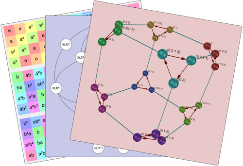
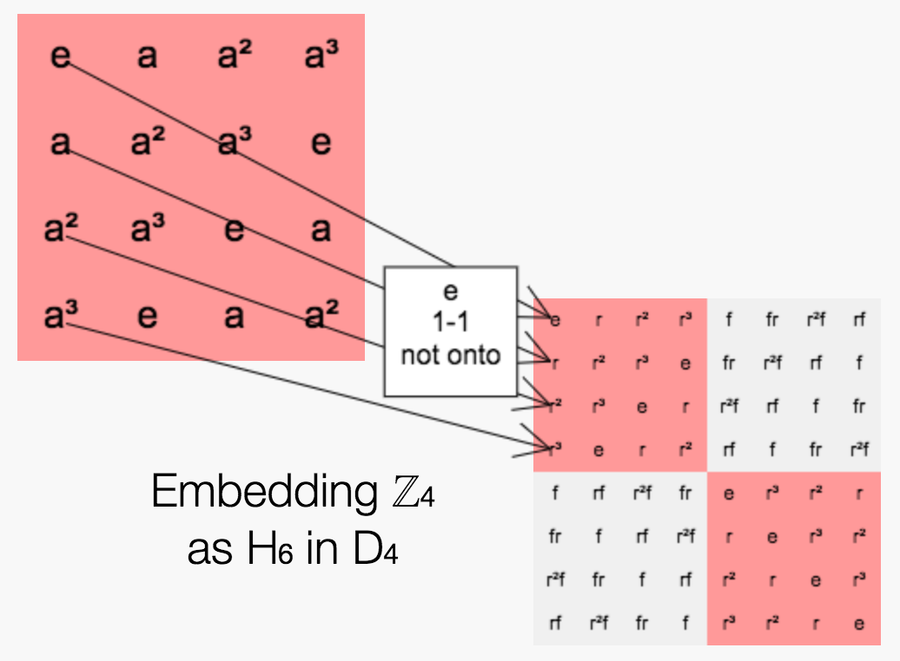
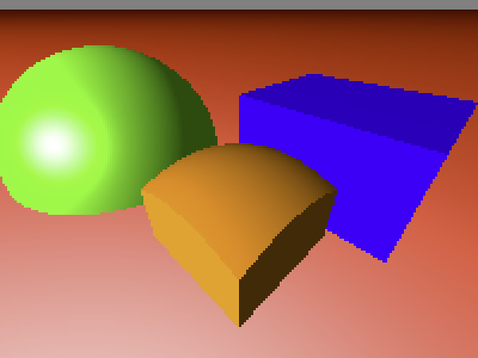
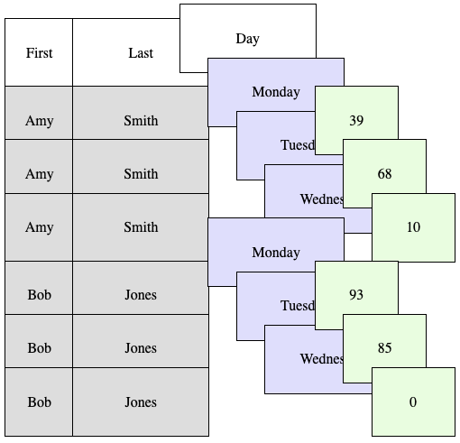
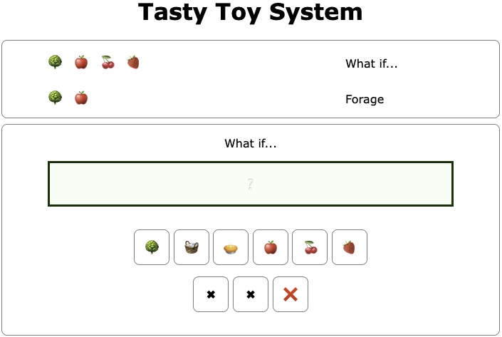
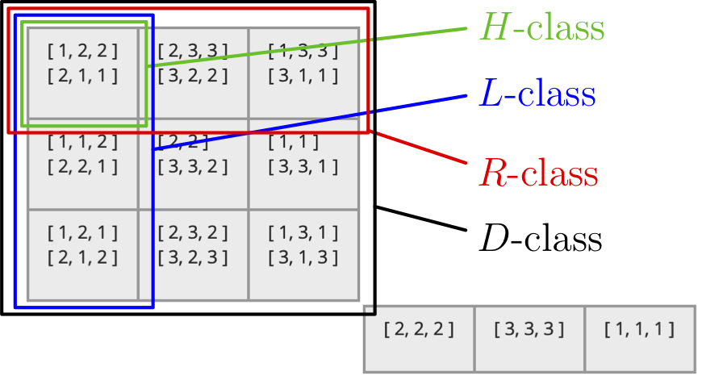

:::: {.columns}

::: {.column width="25%"}

&nbsp;

{fig-align="left" width="150px"}

{fig-align="left" width="150px"}

:::

::: {.column width="75%"}

## Group Explorer

Visualization software for the abstract algebra classroom

[Group explorer website (app, docs, etc.)](https://nathancarter.github.io/group-explorer/)

Ray Ellis and Nathan Carter

Include all groups up to order 20 plus noteworthy groups of higher order.  Runs fully in the browser, supporting Cayley diagrams, multiplication tables, cycle graphs, and other visualization types.  Constructs diagrams of homomorphisms between visualizations to illustrate key group theory concepts, and allows the user to do so as well.

:::

::::

:::: {.columns}

::: {.column width="25%"}

&nbsp;

{fig-align="left" width="150px"}

:::

::: {.column width="75%"}

## How to Data

A free reference for data science students

[How to Data website](https://how-to-data.org/)

Nathan Carter and [several student contributors](https://how-to-data.org/acknowledgments/)

How to Data is a free, online reference site targeted primarily at analytics and data science students. It’s organized around statistical and data-related tasks and shows their implementation in a wide variety of software packages.

:::

::::

:::: {.columns}

::: {.column width="25%"}

&nbsp;

{fig-align="left" width="150px"}

{fig-align="left" width="150px"}

:::

::: {.column width="75%"}

## Teaching tools

 - a [Simple Course Management System](https://github.com/nathancarter/simplecms/blob/master/README.md) addin for RStudio Server Pro, described in [this paper](https://doi.org/10.5070/T5111037029)
 - a very basic [ray-tracing tool in JavaScript](https://github.com/nathancarter/html-ray), useful when teaching the mathematics of computer graphics; see the appropriate chapter from [my textbook on that topic](https://nathancarter.github.io/mocg/site/chapter-6-resources/).
 - [animations for common data table manipulations](https://nathancarter.github.io/dataframe-animations/), which I use when teaching data science.
 - an online tool for [speeding up manual grading of homework assignments in Jupyter notebooks](https://github.com/nathancarter/manual-nb-grader).

I also co-directed [the Lurch project](http://lurch.plus) for many years, but gave that project to Ken Monks in the fall of 2024.

:::

::::

:::: {.columns}

::: {.column width="25%"}

&nbsp;

{fig-align="left" width="150px"}

:::

::: {.column width="75%"}

## Logic games

 - a website where you can [play games on various first-order models](https://nathancarter.github.io/model-games/), such as natural numbers, real numbers, words, or even people
 - a [toy deductive system](https://nathancarter.github.io/tasty-toy-system/) that has little to do with logic, and can be used to illustrate the idea of formal proof in a simple and fun context.

:::

::::

:::: {.columns}

::: {.column width="25%"}

&nbsp;

{fig-align="left" width="150px"}

:::

::: {.column width="75%"}

## Three GAP packages

During the 2018-2019 academic year, I was a research fellow at the University of St Andrews in Scotland, where I worked part-time on [the GAP team](https://circa.st-andrews.ac.uk/).  Although I have not worked on the packages much since then, they include:

 - a package that adds [visualization tools for use in Jupyter notebooks or from the GAP REPL](https://nathancarter.github.io/jupyterviz/).
 - a package that applies the previous one to [visualizing semigroups](https://nathancarter.github.io/semigroupviz/).
 - a package that applies the previous one to [importing group theory visualization tools from Group Explorer](https://nathancarter.github.io/gap-pkg-groupexplorer/).  Group Explorer itself is covered earlier on this page.

:::

::::
