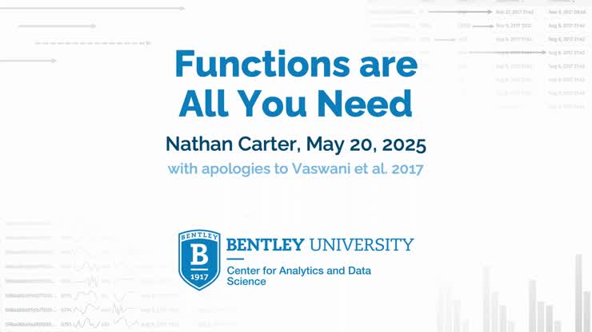
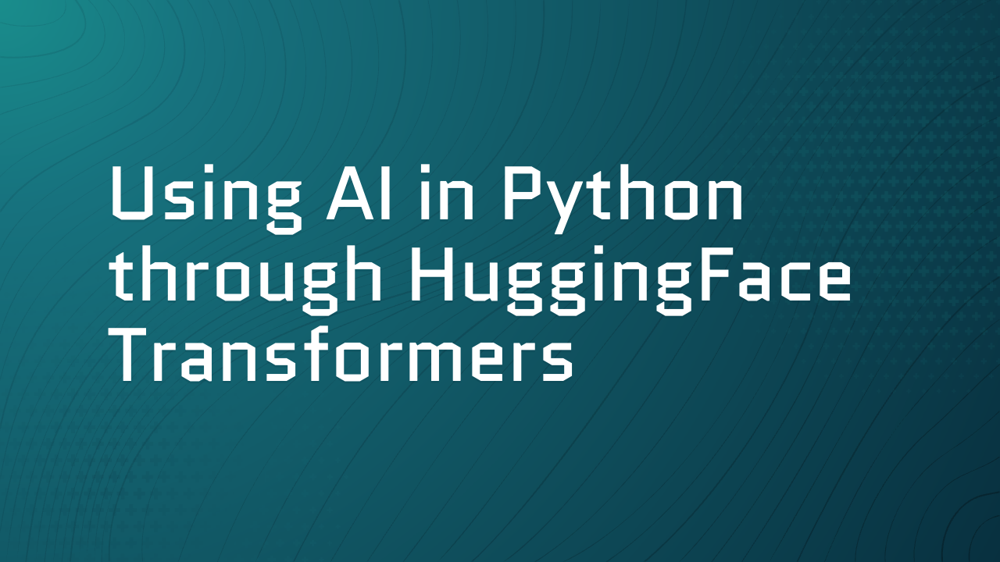
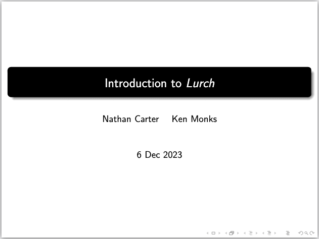
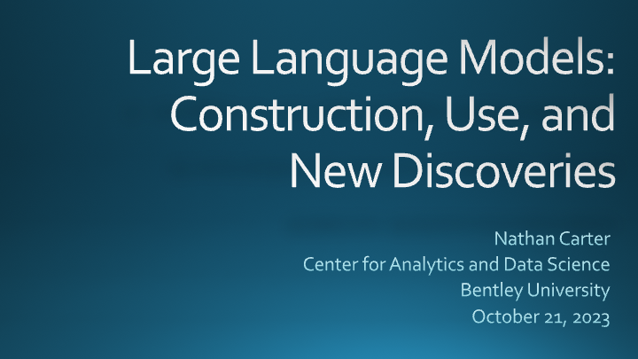
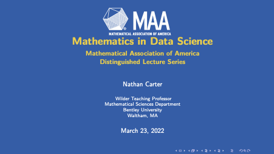
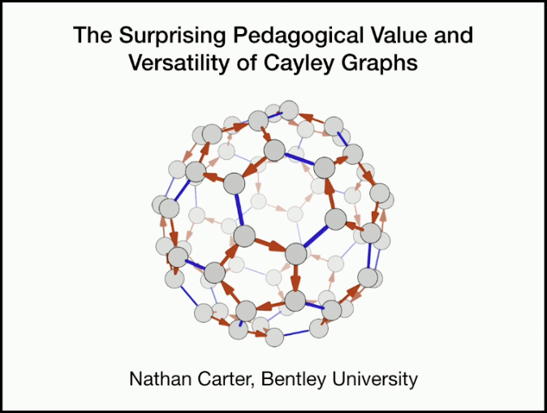

A complete list of talks is on my CV, linked to above.  The talks below are those that were recorded and can be viewed online.

:::: {.columns}

::: {.column width="25%"}

&nbsp;

{fig-align="left" width="150px"}

:::

::: {.column width="75%"}

## Functions are All You Need

Applied Math in Statistics and Data Science Education, ICERM, Brown University, May 20, 2025

[Watch talk online](https://icerm.brown.edu/video_archive/4151){.btn .btn-primary role="button"}

:::

::::

---

:::: {.columns}

::: {.column width="25%"}

&nbsp;

{fig-align="left" width="150px"}

:::

::: {.column width="75%"}

## Using AI in Python through HuggingFace Transformers

Analytics Without Borders conference, Bentley University, April 4, 2025

[Watch talk online](https://videos.bentley.edu/media/t/1_mfzy88lh){.btn .btn-primary role="button"}

:::

::::

---

:::: {.columns}

::: {.column width="25%"}

&nbsp;

{fig-align="left" width="150px"}

:::

::: {.column width="75%"}

## Introduction to Lurch

with Ken Monks, American Institute of Mathematics, Pasadena, CA, December 5, 2023

[Watch talk online](https://vimeo.com/showcase/cyberinfrastructure?share=copy&fl=sc&fe=fs){.btn .btn-primary role="button"}

:::{.callout-note}
I no longer work on the Lurch project, and Ken is in charge of the current version.
:::

:::

::::

---

:::: {.columns}

::: {.column width="25%"}

&nbsp;

{fig-align="left" width="150px"}

:::

::: {.column width="75%"}

## Large Language Models: Construction, Use, and New Discoveries

New England Statistical Society Data Science Day, University of Connecticut, October 21, 2023

[Watch talk online](https://youtu.be/RNJrHWY9Onc?si=_L2iGIq_x2qnJ4Q9){.btn .btn-primary role="button"}

:::

::::

---

:::: {.columns}

::: {.column width="25%"}

&nbsp;

{fig-align="left" width="150px"}

:::

::: {.column width="75%"}

## Mathematics in Data Science

Mathematical Association of America Distinguished Lecture Series, online, March 23, 2022

[Watch talk online](https://www.youtube.com/live/lK5LcwmMn9Y?si=t-2awQdJK77U_xTE){.btn .btn-primary role="button"}

:::

::::

---

:::: {.columns}

::: {.column width="25%"}

&nbsp;

{fig-align="left" width="150px"}

:::

::: {.column width="75%"}

## The Surprising Pedagogical Value and Versatility of Cayley Graphs

Illustrating Number Theory and Algebra Workshop, ICERM, Brown University, October 21, 2019

[Watch talk online](http://icerm.brown.edu/video_archive/2049){.btn .btn-primary role="button"}

:::

::::

