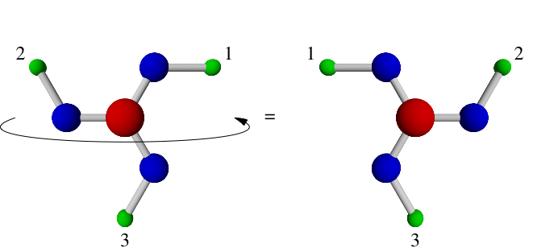
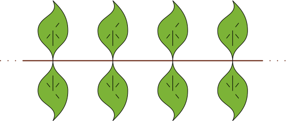
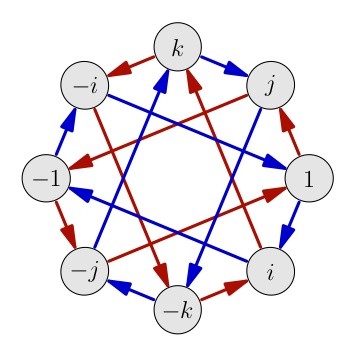
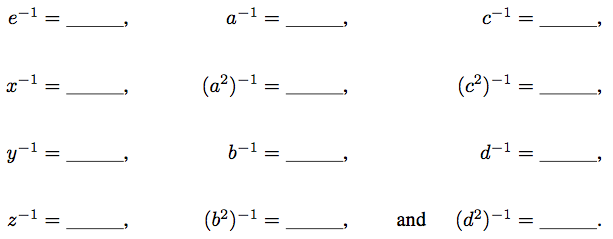
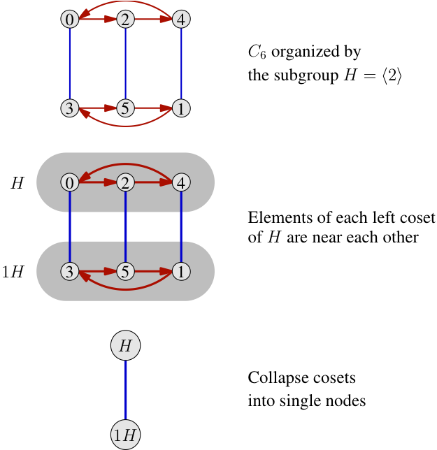
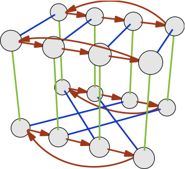
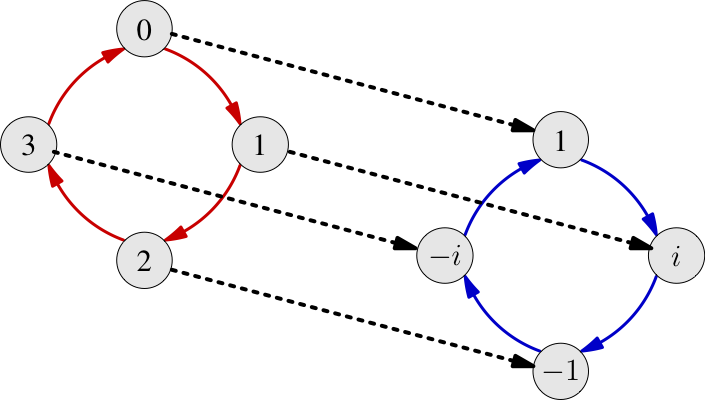
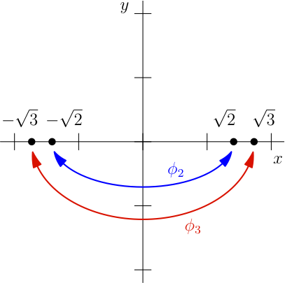
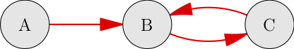
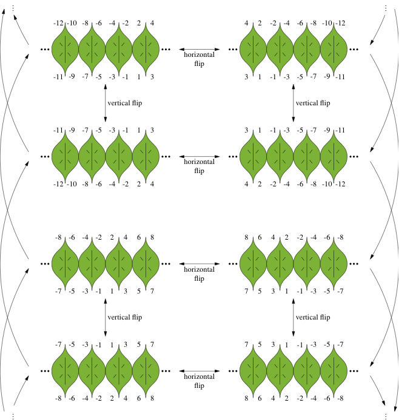

### Chapter 3

#### Page 26, after Definition 3.1

The fourth line of the second paragraph after Definition 3.1 says "Note that new each state..." when it should say "Note that each new state..."

#### Page 28, last paragraph, sixth line

The word admissible is misspelled as "admissable."

#### Page 29, Figure 3.5

The figure has two identical shapes in it, when the one on the right should actually be flipped about a vertical axis. A corrected version of the figure is shown below.

{fig-align="center"}

#### Page 36, paragraph 1

Niels Abel's first name is misspelled as Neils. The correct spelling is Niels.

#### Page 40, Exercise 3.11

Parts (d) and (f) have the same symmetry group, and thus not all six remaining frieze groups are represented by parts (a) through (f), as the introduction to the exercise suggests should be the case. Here is a new figure that is different from the six in the book.

{fig-align="center"}

#### Page 40, Exercise 3.12

Part (c) does not have the same symmetries as any of the figures in the previous exercise; it has the same symmetries as the frieze pattern from Section 3.1.3.

### Chapter 4

#### Page 50, Second paragraph of Section 4.4.2

The Euler number's value is approximately 2.71828, and was mistyped as 2.271828.

#### Page 52, Exercise 4.3

This exercise mentions "commutative" without defining it. It is defined a few pages later, in Exercise 4.23.

#### Page 53, Exercise 4.4

This is not the typical definition of the quaternions. I seem to have $i$ and $j$ mixed up. This doesn't matter at all from a group theory standpoint, because the names are irrelevant; you could call them Ed, Cindy, and Joe, and it would be the same group. But for those who wish to examine the history and uses of the quaternions, my incorrect definition may be a stumbling block. Here is a corrected Cayley diagram for the quaternions, but were this to be adopted into the book, all mentions and uses of the group $Q_4$ throughout the book would need to be examined and updated to use this new structure. I have not done so in this errata.

{fig-align="center"}

#### Page 54, Exercise 4.6(b), line 1

It should read "on the right of Exercise 4.4," rather than Exercise 4.5.

#### Page 54, Exercise 4.6(c), diagram

To stay consistent with other diagrams of the group $A_4$ and how its elements are shown in those diagrams, the blue and red colors in this diagram should be interchanged. (See, for example, the diagram for $A_4$ on page 136.)

#### Page 57, Exercises 4.17 and 4.18

These exercises should be in the other order, since 4.18 asks you why there is only one identity element in a group, and the answer to 4.17 requires you to use the fact that there is only one identity element in a group.

#### Page 60, Exercise 4.26(c) and Page 61, Exercises 4.29 and 4.30

The element naming convention does not match that of the Cayley diagram for $A_4$ on page 54. The elements $a_1$, $a_2$, $b_1$, and $b_2$ should be $a$, $a^2$, $b$, and $b^2$ instead, respectively. It is probably easier to rename the elements in the figure than in the exercises, but either way will fix the problem. Here is an example for how you could correct Exercise 4.26.

{fig-align="center"}

#### Page 61, Exercise 4.28

The exercise attempts to show a difference between abelian and nonabelian groups, but fails in the following way. In part (a), one can cancel $a^2$ and $(a^2)^{-1}$ despite the $x$ between them because the group $C_5$ is abelian; this part of the exercise is correct. In part (b), the group is $Q_4$, a nonabelian group, and in general it is not acceptable in nonabelian groups to rearrange elements to permit cancelling. However, in this case, the example chosen was a poor example, because the solution to part (b) is $x = j$, which one could obtain by naively canceling the $i$ and $i^{-1}$. Although this strategy does not work in every nonabelian example, it works in this one.

A correct version of the exercise would use a different example for part (b), such as the equation $a^2 x (a^2)^{-1} = d$ in the group $A_4$ from page 54. The solution would be $x = b$, which we would not get through naive cancelling. If we attempted to cancel the $a^2$ with $(a^2)^{-1}$, we would find $x = d$ instead, which is incorrect.

### Chapter 5

#### Page 68, caption to Figure 5.7

The $C_5$ should be a $C_7$.

#### Page 69, second paragraph

The paragraph mentions Exercise 4.6 as stating that Cayley diagram arrows represent multiplication on the right. Although arrows do indeed mean right multiplication, Exercise 4.6 does not actually say so. The first place such a statement seems to appear is in Section 4.2, but it is not explicit. Exercise 4.6 should probably be enhanced to say what this paragraph claims that it says.

#### Page 71, Section 5.2.3, first paragraph

This paragraph encourages you to examine Figure 5.13, which contains a new phenomenon that was not yet completely explained. The bottom cycle graph in Figure 5.13 does not show the cycle $\{(e,e),(e,a^2)\}$ directly. It only shows it as a subset of the cycle $\{(e,e),(e,a),(e,a^2),(e,a^3)\}$. The text on page 71 should therefore clarify that cycles that are subsets of other cycles only show up as such, without the extra edges that the cycle graph would require to show that $\{(e,e),(e,a^2)\}$ is a cycle in its own right.

#### Page 71, last lines

The phrase "the right of Figure 5.9" should say "the left of Figure 5.9."

#### Page 80, definition of $A_n$

I define $A_n$ as the set of squares of elements of $S_n$, but this is erroneous! I had done this in an attempt to avoid the "standard" definition, because it requires defining parity of permutations first, which I wanted to avoid.

For the purposes of Chapter 5, you can let the definition I give stand, because it is equivalent to the correct definition for $n < 6$, and I only discuss alternating groups smaller than or equal to $A_5$. But my definition becomes incorrect at $n = 6$.

For the correct definition, I refer the reader to a reputable online source, [here](http://mathworld.wolfram.com/AlternatingGroup.html).

#### Page 81, caption for Figure 5.26

The word "comprised" should be "composed" instead.

#### Page 82, Figure 5.27

To stay consistent with other diagrams of the group $A_4$ and how its elements are shown in those diagrams, the blue and red colors in this diagram should be interchanged. (See, for example, the diagram for $A_4$ on page 136.)

#### Page 93, Exercise 5.33(e)

The presentation has an extra inverse at the end that should not be there. Instead, the exercise should read as follows:

Sketch a Cayley diagram for the group $\langle a, b \mid a^4 = 1,\ b^4 = 1,\ a^2 = b^2,\ bab = a \rangle$.

#### Page 94, Exercise 5.38

The term "order" is used in this exercise but not defined. Thus this exercise belongs later in the book, after that term has been defined. (You can find its definition on page 110, in Exercise 6.11.)

#### Page 95, Exercise 5.41(c)

The reference to Figure 2.10 should instead be a reference to Figure 4.7.

#### Page 96, Exercise 5.44, first line of paragraph before (a)

The $C_5$ should be an $S_5$.

### Chapter 6

#### Page 97, line 6

The word "moreso" should be two words, "more so."

#### Page 111, Exercise 6.18(a)

Could be more clearly worded as follows:

What is the one coset of $\langle 2 \rangle$ in $\mathbb{Z}$ (besides the subgroup $\langle 2 \rangle$ itself)?

### Chapter 7

#### Page 118, Definition 7.1

This definition would be better with the factors swapped, so that it is consistent with Definition 8.9, of semidirect products. It would also therefore be clearer to use $A$ and $B$ in that latter definition, rather than $G$ and $H$.

#### Page 122, second line from the bottom

The non-word "inthe" should be the two words "in the."

#### Page 123, lines 3 and 4

The notation for $S_3$ is inconsistent with earlier uses of that group (e.g., Figure 5.17). Elements should be named $e$, $r$, $r^2$, $f$, $fr$, $fr^2$.

#### Page 125, Figure 7.11

The phrase "diagram from $D_4$" should be "diagram of $D_4$."

#### Page 128, Figure 7.14

The caption mistakenly says that $a$ is the red generator and $b$ is the blue generator, but that is backwards. Actually, $a$ is blue and $b$ is red.

#### Page 133, Figure 7.20

The elements in the bottom row of each copy of $C_6$ are labeled incorrectly. Since the blue generator indicates the action of adding 3 mod 6, the figure should instead look like the one shown here.

Also, in this figure, as in Figures 7.21, 7.23, and 7.26, the phrase "Left cosets of $H$ are near each other" is not really accurate. It should say "Elements in each left coset of $H$ are near each other." (And although $1H$ is an accurate name for the coset, $3H$ would probably be clearer.)

{fig-align="center"}

#### Page 137, proof of Theorem 7.6, sentence 3

A useful clarification would be to add to the end of that sentence this parenthetical comment: (though probably involving fewer colors).

#### Page 138, Figure 7.26

To stay consistent with other diagrams of the group $A_4$ and how its elements are shown in those diagrams, the blue and red colors in this diagram should be interchanged. (See, for example, the diagram for $A_4$ on page 136.)

#### Page 140, third line of second-to-last paragraph

The notation $N_{V_4}(A_4)$ should instead be $N_{A_4}(V_4)$.

#### Page 144, third sentence of last paragraph

It reads, "As before, I use the names $a$, $b$, $c$, and $d$ in $A_4$ to represent the four 120-degree clockwise rotations..." which is misleading. I had not given any interpretation to those symbols before page 144. I had used them to *label* nodes in Figure 7.23 on page 136, but did not give them any *interpretation* until page 144.

#### Page 150, Exercise 7.18(f)

The image has some problems with depth; all the nodes are rendered on top of the lines. It should look like this instead.

{fig-align="center"}

#### Page 155, Exercise 7.37

It should say that Figure 7.33 shows that $a$ and $b$ are conjugates, not $a$ and $c$.

### Chapter 8

#### Page 163, Figure 8.8

Two elements in the group of complex numbers are missing their negative signs. The figure should instead look like the one shown here.

{fig-align="center"}

#### Page 166, paragraphs 2-4

I argue that the $C$ is closed, but not that it contains the inverse of each element. Such an argument is sufficient for finite groups, but not for arbitrary groups. A proof that $C$ contains its elements' inverses would go like this:

First observe that any homomorphism must map the identity element of the domain to the identity element of the codomain. Take the equation $a \cdot e = a$ in the domain; through the homomorphism it becomes $\phi(a) \cdot \phi(e) = \phi(a)$. This equation tells us that the path $\phi(e)$ leads from $\phi(a)$ right back to $\phi(a)$ again. Thus it must either be the empty path or a loop that's equivalent to it, meaning that it's the identity element in the codomain.

Now back to proving that $C$ contains the inverse of each of its elements. Assume $a$ is in $C$. That means that the equation $a \cdot a^{-1} = e$ in the domain becomes the equation $\phi(a) \cdot \phi(a^{-1}) = e$ in the codomain (using the fact that $\phi(e) = e$ that we just proved). In other words, following the $\phi(a)$ path and then the $\phi(a^{-1})$ path returns you back to where you started. Thus the image of $a^{-1}$ is just the reverse path of the image of $a$, and so if one is in $C$ then so is the other.

#### Pages 173-174, Figures 8.19 and 8.20

The order of $\times$ is reversed here from what it had been in Chapter 7. Where it says $C_3 \times C_4$, it should instead say $C_4 \times C_3$. Similarly, $C_n \times C_m$ should say $C_m \times C_n$. Similar changes in the text surrounding the figures may also be required.

#### Page 175, second paragraph of Section 8.5

Where it says "the leftmost pattern in Figure 5.8" it should instead say "the right of the two patterns in Figure 5.8."

#### Page 177, first paragraph

Twice I mention Long Island, when instead it should say Manhattan.

#### Page 182, Exercise 8.13

This exercise should be stated for abelian groups only. The function defined there is not a homomorphism for all groups, but is a homomorphism for all abelian groups.

#### Page 183, Exercise 8.15

The text after the exercise suggests that the identity element is not a commutator. I would rewrite sentence 2 of that paragraph as follows: Elements of that form are called *commutators.*

#### Page 184, Exercise 8.24

The equation should read $an = bm + 1$.

#### Pages 185-186, Exercises 8.29 and 8.30

Throughout these exercises, the semidirect products are written in the wrong order. For instance, in 8.29 part (a), because $\theta : C_2 \to \mathrm{Aut}(C_5)$, it should ask about the semidirect product of $C_5$ with $C_2$, not the other way around. The same error is repeated in parts (c) and (d); in each case, the homomorphisms are correct and the product notation is backwards. In 8.30 it should speak of the product of $C_3$ with $C_4$.

#### Page 187, Exercise 8.40

It should ask you to find an isomorphism between $\mathbb{Q}^+ \times C_2$ and $\mathbb{Q}^*$, not between $\mathbb{Q} \times C_2$ and $\mathbb{Q}^*$.

#### Page 189, Exercise 8.43

The second paragraph contains the sentence beginning "Consider the homomorphism $\theta : H \times K \to G$." It should be changed to begin with "Consider the function $\theta : H \times K \to HK$." This is for two reasons. First, it is not always a homomorphism unless we have the assumption given in part (a). Second, it is not an isomorphism onto all of $G$, but only onto its image, $HK$.

### Chapter 9

#### Pages 198-199, proof of Theorem 9.4

This proof is done by counting the number of left cosets of $\mathrm{Stab}(s)$ in $G$, but it should instead be done by counting the number of right cosets of that same subgroup. Although of course the number of cosets is the same either way, the way currently used in the book requires treating the sequence of actions $\phi(g)\phi(h)$ as if the one on the right applies first. This convention is common in mathematics, but is not the convention used in the rest of the textbook! Thus to stay consistent, I should use right cosets and swap all the left and rights in the proof of the theorem.

#### Page 199, first displayed equation

The first $\mathrm{Stab}(S)$ should be $\mathrm{Stab}(s)$.

#### Page 206, Proof of Theorem 9.9

The first sentence says $\phi : G \to \mathrm{Perm}(S)$, but it is $H$ that is acting on $S$, so it should instead read $\phi : H \to \mathrm{Perm}(S)$.

#### Page 211, first paragraph

The final sentence of the paragraph references Figure 9.6, when it should reference Figure 9.13.

#### Page 215, Proof of Theorem 9.12

The final paragraph could be clarified by changing the phrase "and thus it is not zero" to "and thus it is not zero mod $p$."

#### Page 219, Exercise 9.16

Although the word $\mathrm{Ker}$ in this exercise has extra spaces in it, it has the same meaning as elsewhere in the text, where it is typeset correctly. See also the erratum on page 292.

#### Page 220, Exercise 9.27

No reason is given for why $ba$ must be some $a^m b$. Why could it not be $a^m b^2$? You can prove that this cannot be the case in a number of different ways. Consider, for example, showing that $\langle a \rangle$ is a normal subgroup.

### Chapter 10

#### Page 241, Figure 10.13

The figure uses red and blue backwards. In order to be consistent with Figure 10.12, the red should be blue and vice versa. Here is a corrected version.

{fig-align="center"}

#### Page 242, line 6

The phrase "neither $r_1$ nor $r_2$" should be "neither $r_2$ nor $r_3$."

#### Page 246, Figure 10.20

The subgroups in the figure marked as $V_4$ should be marked as $C_4$ instead. Furthermore, the equality signs in the figure are incorrect; the groups are isomorphic, not equal. (The congruence sign should be used instead.)

#### Page 249, paragraph above 10.7.2

The following sentence is inaccurate.

> Furthermore, no group containing $A_5$ can be solvable, because the smallest first step in any chain of normal subgroups in such a group would be the invalid step $\{e\} \vartriangleleft A_5$.

It should be rewritten along the following lines.

> Furthermore, no group containing $A_5$ can be solvable. No step $A \vartriangleleft B$ in such a chain can have the quotient $B/A$ isomorphic to $A_5$, because it is not abelian. And yet it can also be shown that a step in the chain including just "part" of $A_5$ could be used to reveal a normal subgroup in $A_5$, an impossibility.

#### Page 253, Exercise 10.4

In part (a), step 2 actually yields $\dfrac{-x^2 - x - 2}{x^2 + 1}$.

#### Pages 253-254, Exercise 10.6

Every occurrence of $24x$ in the example polynomial division should actually be $26x$.

#### Page 255, Exercise 10.9

In part (e), you may also assume that $\sqrt{6}$ is irrational.

#### Page 258, Exercise 10.22

See the erratum for the solution to part (c), below. The same problem does not appear in any of the other three parts of this exercise, because in each case, arguments that are not too difficult can be made for the irreducibility of the resulting polynomial.

#### Pages 259-260, Exercise 10.29

The exercise claims to show the diagrams of finite fields of orders 5 and 8, but from the diagrams it is clear that this is a typo; they show the finite fields of orders 4 and 8. Thus when part (b) of the problem asks you to create the diagram for the finite field of order 4, this does not make sense since you were already given it. Consider instead creating the diagram for the finite field of order 5.

### Appendix

#### Page 263, Answer to Exercise 2.15

The diagram shown in the text as a solution to this exercise violates not only Rule 1.6, as assigned, but also Rule 1.8, as described in the solution to Exercise 2.17. However, the assignment was to violate only Rule 1.6, not any of the others. A diagram like the following would be better, in which we find that from the point B, it is not clear what the inverse of the red arrow would mean.

{fig-align="center"}

#### Page 264, Figure A.2

The figure was incorrect in two ways; the right-hand friezes in the top square were incorrectly labeled, and the arced arrows along the right side were backwards. A corrected version appears here.

{fig-align="center"}

#### Page 270, Answer to Exercise 6.26 (b).

The 8 should be a 6.

#### Page 270, Answer to Exercise 7.9

This is mislabeled. It is actually the answer (well, actually, the hint) for Exercise 7.10.

#### Page 272, Answer to Exercise 7.33(b)

The phrase "for the first two odd $D_n$" should instead be "for $D_n$ for the first two even $n$."

#### Page 273, Answer to Exercise 8.4(c)

The map $\theta_3$ should be $\theta_3(x) = 4 - x \pmod{4}$.

#### Page 273, Answer to Exercise 8.6

Part (b) is ambiguous. It asks if the set of elements to which $\phi$ maps $K$ will be normal, but it does not say normal in what group. It will always be normal in $\mathrm{Im}(\phi)$, but not always normal in $H$.

#### Page 274, Answer to Exercise 8.16

The hint assumes that an arbitrary element of $H$ is a commutator, which is not guaranteed by the definition of that subgroup. The commutator subgroup was defined as being generated by commutators, not equal to the set of commutators. Thus we must assume that the arbitrary element of $H$ is a product of commutators, and thus looks like the much less pleasant expression $g\, a_1 b_1 a_1^{-1} b_1^{-1} \cdots a_n b_n a_n^{-1} b_n^{-1}\, g^{-1}$. And you should be able to multiply this by some commutators to yield an element of $H$, that is, a product of commutators.

#### Page 275, Answer to Exercise 8.29

The $Z_n$ should be $C_n$ instead.

#### Page 278, Answer to Exercise 9.12

It should instead state that Exercise 6.31 guides you through creating the counterexample that Exercise 9.12 requests.

#### Page 279, Answers to Exercises 9.22(c) and 9.27

The same correction regarding the order of factors in the semidirect product applies here as it did in earlier exercises. The product of $C_4$ with $C_3$ should be $C_3$ with $C_4$ instead, and the product of $C_3$ with $C_7$ should be $C_7$ with $C_3$ instead.

#### Page 282, Answer to Exercise 10.22(b)

The polynomial I create may be irreducible, but it is not obvious whether it is or not. I should have designed the exercise better; consider instead changing the 1 to a 2, so that $r=\sqrt[5]{2 + \sqrt{2}}$. Then the polynomial created is $r^{10} - 4r^5 + 2$, which is irreducible by the Eisenstein Criterion (Theorem 10.4).

### Index

#### Page 292, homomorphism kernel

Appears redundantly, due to typesetting error on page 219.
