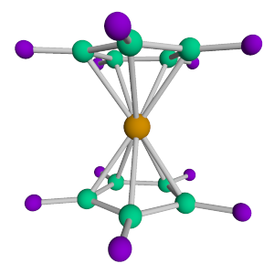
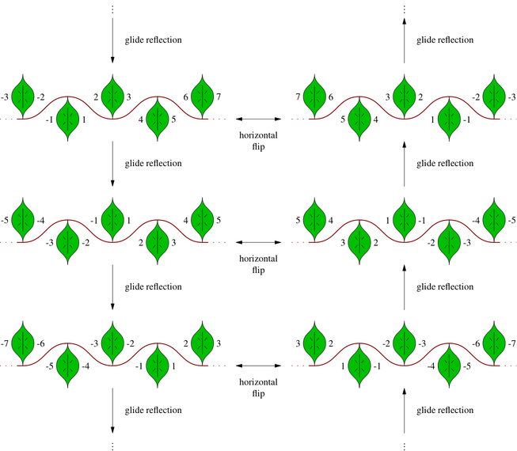
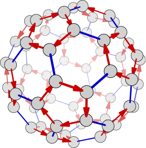
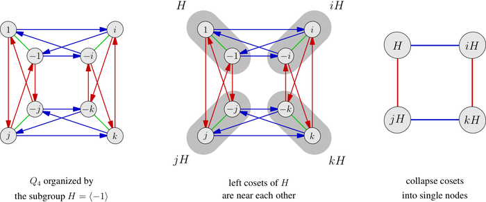
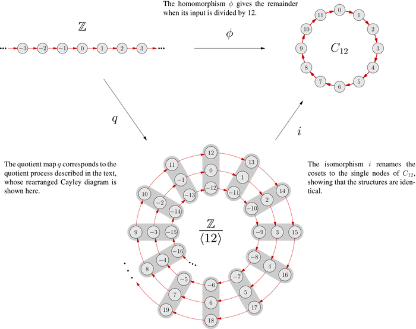
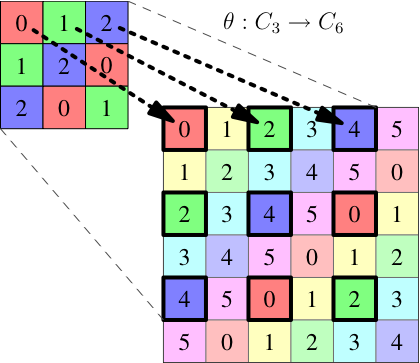
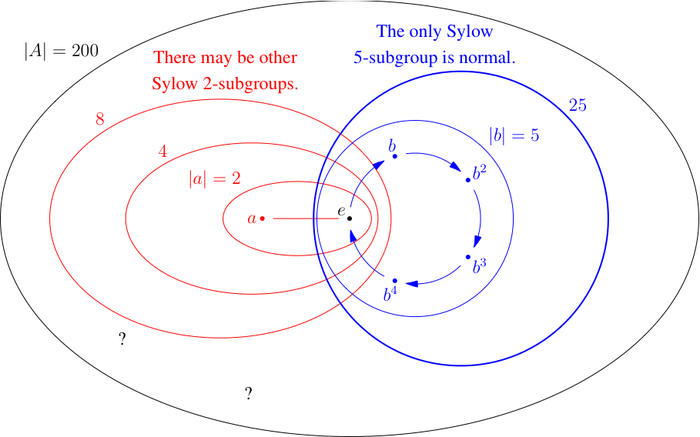
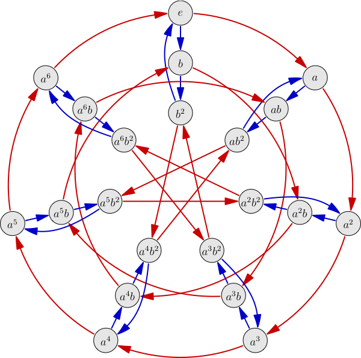

These images are not provided as an educational resource, but to give you an idea of the textbook's style. Therefore they are not self-explanatory. If you are familiar with group theory, you may be able to understand many of these images with only the brief descriptions provided. If not, or you are new to group theory visualization, you can learn more from the documentation that comes with [Group Explorer](https://nathancarter.github.io/group-explorer/) (available online for free).

## The two-lightswitch group (from Chapter 2)

:::: {.columns}

::: {.column width="30%"}

The two-lightswitch group has two generators, the actions of flipping one switch, or the other. This image shows a Cayley diagram for the two-lightswich group, isomorphic to the Klein 4-group.

:::

::: {.column width="5%"}
<!-- gap -->
:::

::: {.column width="65%"}

{fig-align="center" width="100%"}

:::

::::

## A molecule of eclipsed ferrocene (from Chapter 3)

:::: {.columns}

::: {.column width="50%"}

{fig-align="center" width="100%"}

:::

::: {.column width="5%"}
<!-- gap -->
:::

::: {.column width="45%"}

Group theory has many applications, in science, art, and many other areas, including other branches of mathematics. One of its applications is the study of the shapes of molecules and molecular crystals. Chapter 3 teaches how to compute the symmetry group of a molecule like the one shown here.

:::

::::

## Symmetries of a frieze pattern (from Chapter 3)

:::: {.columns}

::: {.column width="35%"}

One application of group theory to art is understanding the symmetry in repeated patterns. Frieze patterns like the one in this figure repeat in one dimension. This diagram shows the structure of the frieze pattern's symmetry.

:::

::: {.column width="5%"}
<!-- gap -->
:::

::: {.column width="60%"}

{fig-align="center" width="100%"}

:::

::::

## The alternating group $A_5$ (from Chapters 5 and 10)

:::: {.columns}

::: {.column width="60%"}

{fig-align="center" width="100%"}

:::

::: {.column width="5%"}
<!-- gap -->
:::

::: {.column width="35%"}

The alternating group $A_5$, half of all possible permutations of five items, has 60 elements. Its structure is integral to the proof that quintic polynomials have no general solution by basic arithmetic and radicals. This image is a Cayley diagram of the group, illustrating its stability, structure, and symmetry.

:::

::::

## The quotient process (from Chapter 7)

Some groups contains normal subgroups, which can organize the overall structure of the larger group, and enable simplification of that structure by taking a group quotient. This figure shows the quotient process that divides the quaternion group $Q_4$ by a subgroup isomorphic to $C_2$ and obtains a group isomorphic to the Klein 4-group.

{fig-align="center" width="100%"}

## An infinite quotient (from Chapter 7)

The quotient process can also be performed on infinite groups. In this diagram, the group of integers $\mathbb{Z}$ is divided by the subgroup $\langle 12 \rangle$ to create a structure in which arithmetic takes place mod 12. That structure is then shown to be isomorphic to the group $C_{12}$, using a triangle of homomorphisms as given by the Fundamental Homomorphism Theorem.

{fig-align="center" width="100%"}

## A homomorphism between multiplication tables (from Chapter 8)

:::: {.columns}

::: {.column width="60%"}

{fig-align="center" width="100%"}

:::

::: {.column width="5%"}
<!-- gap -->
:::

::: {.column width="35%"}

Homomorphisms can be visualized between Cayley diagrams, multiplication tables, and cycle graphs. This illustration shows an embedding of the group $C_3$ in the group $C_6$ using dotted arrows between multiplication tables.

:::

::::

## Sylow Theory (from Chapter 9)

:::: {.columns}

::: {.column width="35%"}

Sylow Theory provides information about what structures are guaranteed to exist within a group, based only on the group's order. In this figure, we see that the fact that the group $A$ has order 200 leads to conclusions about groups it has of orders 2, 4, 8, 5, and 40.

:::

::: {.column width="5%"}
<!-- gap -->
:::

::: {.column width="60%"}

{fig-align="center" width="100%"}

:::

::::

## Nonabelian group of order 21 (from Chapter 9)

Sylow Theory also helps classify all groups of a given order. Using the Sylow Theorems to analyze groups of order 21 produces two results, one abelian group $C_{21}$ (isomorphic to $C_3 \times C_7$) and one nonabelian group, whose intricate Cayley diagram is shown here. Notice how Cayley diagrams communicate even this intricate structure beautifully.

{fig-align="center" width="100%"}
