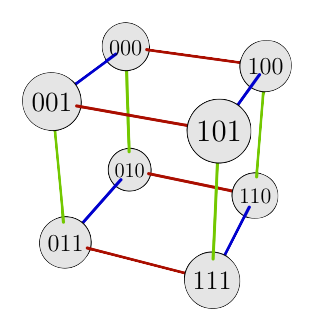

Mathematics Association of America Press, 2009

:::: {.columns}

::: {.column width="45%"}

[Table of contents](files/vgt-contents.pdf){.btn .btn-secondary role="button"}
[Preface](files/vgt-preface.pdf){.btn .btn-secondary role="button"}
[Overview](files/vgt-overview.pdf){.btn .btn-secondary role="button"}

Group theory is the branch of mathematics that studies symmetry, found in crystals, art, architecture, music, and many other contexts. Its beauty is often lost on students because it is typically taught in a technical style that is difficult to understand.

*Visual Group Theory* assumes only a high school mathematics background and covers a typical undergraduate course in group theory from a thoroughly visual perspective. Its more than 300 illustrations cover groups, subgroups, homomorphisms, products, quotients, Sylow theory, and a preview of Galois theory. [Group Explorer](https://nathancarter.github.io/group-explorer/), optional accompanying software, is available free online.

Visual Group Theory is published in the [MAA](http://www.maa.org/)'s Classroom Resource Materials series, and won that organization's [Beckenbach Book Prize](http://maa.org/news/jmm2012awards/beckenbach.html). Sample materials from the book are available from the links above. Supplementary material appear below.

:::

::: {.column width="10%"}
<!-- gap -->
:::

::: {.column width="45%"}

[Gallery of images](vgt-gallery.qmd){.btn .btn-primary role="button"}
[Errata](vgt-errata.qmd){.btn .btn-warning role="button"}

[Publisher website](https://bookstore.ams.org/clrm-32/){.btn .btn-info role="button"}
[Amazon page](https://www.amazon.com/Visual-Theory-Classroom-Resource-Materials/dp/1470464330){.btn .btn-info role="button"}

{fig-align="center" width="150px"}
{fig-align="center" width="150px"}

> It's one of the best introductions to group theory---or to any branch of higher math---I've ever read.  ---[Steven Strogatz](http://opinionator.blogs.nytimes.com/2010/05/02/group-think/), Cornell University

> I had two students email me and tell me that they picked up your book to thumb through after it came in the mail and suddenly found themselves actually <u>reading</u> the book. Both students indicated that this caught them by surprise because they didn't intend to start reading it and that they had never really read a math textbook before.  ---[Dana Ernst](https://danaernst.com/), Northern Arizona University

:::

::::
